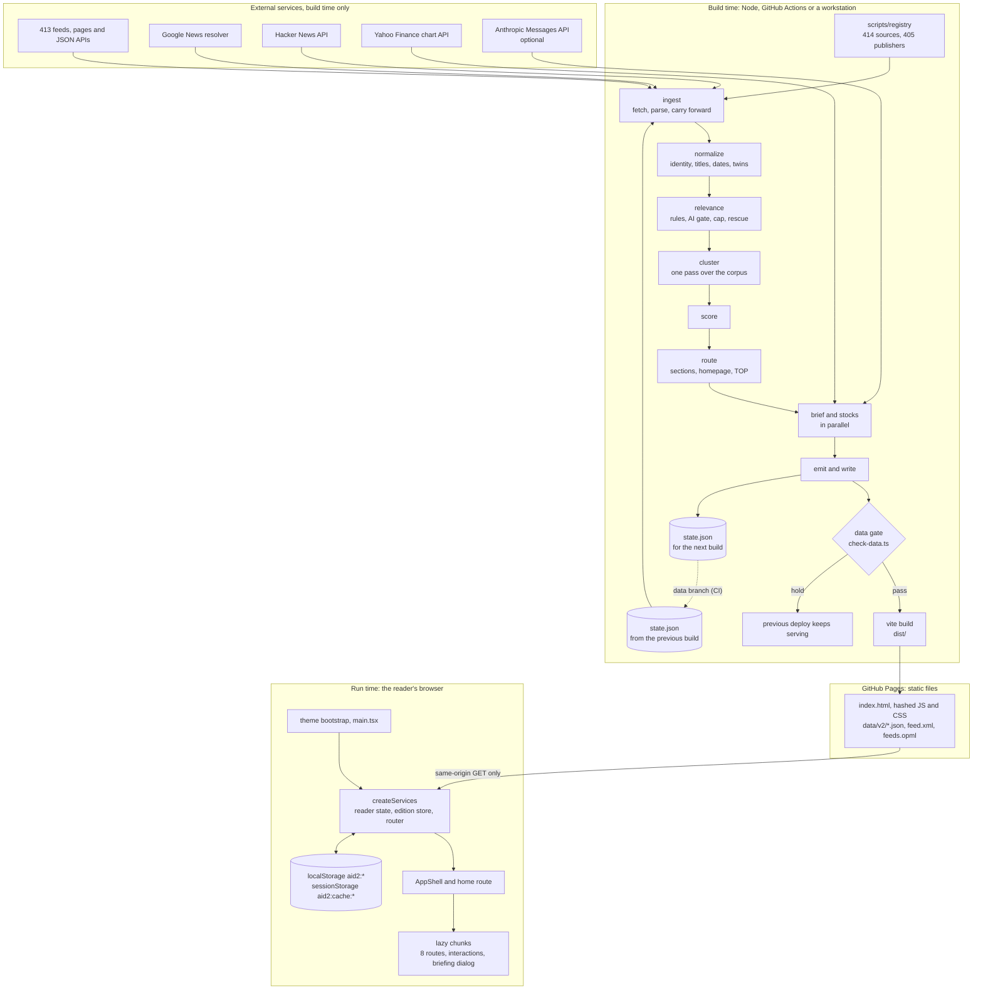

# AI DRUDGE V2 — Design

How V2 is built and why: the build-time pipeline, the data it publishes, the client that renders
it, CI/CD, budgets, tests and the decisions behind them. Verified against the repository on
2026-11-20 (branch `v2`, uncommitted worktree). Written against the data build of 04:16:25Z and
brought up to the closing round of the same day (data build `2026-11-20T05:16:55.936Z`); each
measured table names its build.

| Question | Answer |
|---|---|
| What is it | A static, Drudge-style AI news page. A Node pipeline reads 413 active sources and writes JSON; a React SPA renders that JSON. No server, no database, no accounts. |
| Where is the logic | Ranking, clustering and placement are decided at build time in `scripts/pipeline/`. The client only filters (mutes, time chips, search) and renders. |
| Where are the type contracts | `shared/contract.ts`, `scripts/pipeline/types.ts`, `src/app/services.ts`. Map: [CONTRACTS.md](./CONTRACTS.md). This document does not repeat them. |
| What has never run | Nothing has run on GitHub, nothing was checked in a browser in the last two rounds, and the model-written brief has never called the API. See [section 12](#12-not-verified). |

Related documents: [CONTRACTS.md](./CONTRACTS.md) (types, commands, fixture procedure),
[DEPLOYMENT.md](./DEPLOYMENT.md) (go-live), [SECURITY.md](./SECURITY.md) (threat model),
[SOURCES.md](./SOURCES.md) (every source, generated), [SOURCE_RESEARCH.md](./SOURCE_RESEARCH.md)
(source backlog and dead ends), [REVIEW_2026-11-20.md](./REVIEW_2026-11-20.md) (review findings),
[PROJECT_HISTORY.md](./PROJECT_HISTORY.md), [CHANGELOG.md](./CHANGELOG.md), [SBOM.md](./SBOM.md).

## Contents

1. [Goals and non-goals](#1-goals-and-non-goals)
2. [Architecture](#2-architecture)
3. [Stack and layout](#3-stack-and-layout)
4. [Pipeline](#4-pipeline)
5. [Data contract (summary)](#5-data-contract-summary)
6. [Client](#6-client)
7. [CI/CD](#7-cicd)
8. [Performance budgets and measured values](#8-performance-budgets-and-measured-values)
9. [Testing strategy](#9-testing-strategy)
10. [Failure modes](#10-failure-modes)
11. [Decisions and trade-offs](#11-decisions-and-trade-offs)
12. [Not verified](#12-not-verified)
13. [Where to change what](#13-where-to-change-what)

---

## 1. Goals and non-goals

### Goals

| # | Goal | Mechanism |
|---|---|---|
| 1 | One dense page of the day's AI news, readable in a minute | 15 sections, 143 homepage rows, TOP STORIES of at most 12 (`shared/sections.ts`, `shared/contract.ts` `TOP_STORIES_MAX`) |
| 2 | Significance comes from how many publishers report a story, not from feed priority or keywords | Corpus-wide clustering before routing; coverage is the largest score term (`scripts/pipeline/cluster/`, `scripts/pipeline/score/weights.ts`) |
| 3 | Serve one reader's beats first: AI security, local and open models, AI-in-finance regulation, model releases | AI SECURITY has the highest rule weight; regulator floor in POLICY; section focus in LOCAL, POLICY and AI SECURITY (`scripts/pipeline/route/rules.ts`) |
| 4 | Every placement is explainable after the fact | `npm run explain` reads a per-build record of score parts, route trace and drops (`scripts/pipeline/emit/explain.ts`, `scripts/tools/explain.ts`) |
| 5 | A bad build never replaces a good site | Zero-article guard, data gate with freshness check, deploy only after the gate (`scripts/pipeline/run.ts`, `scripts/tools/check-data.ts`, `.github/workflows/refresh.yml`) |
| 6 | Least privilege and auditability | Third-party feeds are fetched and parsed without the API key; per-job token scopes; actions pinned by commit SHA; AI output labelled with its model id ([SECURITY.md](./SECURITY.md)) |
| 7 | V1 readers keep their state | Article ids are V1's djb2 hash of the canonical URL (`shared/ids.ts`); one-time import of V1 `localStorage` (`src/state/migrateV1.ts`) |
| 8 | Deterministic and testable | Stages are pure functions of their input, `ctx.now` and `ctx.state`; the clock and `fetch` are injected (`scripts/pipeline/context.ts`) |

### Non-goals

| Non-goal | Consequence |
|---|---|
| A server, an API or user accounts | All personalisation is `localStorage`; routing is `location.hash`; hosting is GitHub Pages |
| Fetching third-party content in the browser | The client requests same-origin JSON only; the production CSP is `connect-src 'self'` (`vite.config.ts`) |
| Republishing article text | Titles (200 chars), summaries (320 chars) and links only; the lead's summary only, never a member's |
| Model-made ranking or classification | Relevance, clustering, scoring and routing are rules and arithmetic. The one model call writes the optional Daily Brief and is validated in code (`scripts/pipeline/enrich/brief.ts`) |
| Real-time updates | 30-minute build cadence; the client re-checks every 10 minutes while the tab is visible |
| A general news site | Sources of scope `general` pass an AI-relevance gate; two owner-interest wires (CYBER WIRE, QUANTUM WATCH) are deliberately exempt and never feed TOP STORIES |

---

## 2. Architecture



Two properties define the design:

1. **All third-party network I/O happens at build time.** The browser talks to its own origin only.
2. **One build is one consistent data set.** Every published file carries the same `buildId`; the
   client refuses to merge files of different builds (`shared/select.ts` `mergeEdition`,
   `BuildMismatchError`).

---

## 3. Stack and layout

### 3.1 Stack (from `package.json`, `.node-version`)

| Layer | Choice | Notes |
|---|---|---|
| UI | React 19.3, TypeScript 6.0 | The only runtime dependencies are `react` and `react-dom` |
| Build | Vite 8.3, `@vitejs/plugin-react` 6.3 | `base` from `SITE_BASE` (default `/ai-drudge-v2/`), target `es2022`, no modulepreload polyfill (`vite.config.ts`) |
| Styling | Tailwind CSS 4.3 with source detection off; hand-written token, base, chrome and component layers | `src/styles/index.css` scans `src/` and `index.html` only |
| Pipeline runtime | Node 24 in CI (`.node-version`), `engines.node >= 22.15.0`; `tsx` 4.23 runs TypeScript directly | No bundling of pipeline code |
| XML | `fast-xml-parser` 5.12 | The one third-party parser the pipeline loads; everything else (HTML tree, dates, URLs, entities) is in-repo code |
| Tests | `node:test` through `tsx --test` | No test framework dependency, no DOM library |
| Hosting | GitHub Pages | Static only; cannot send response headers, hence the `<meta>` CSP |
| CI | GitHub Actions | `refresh.yml`, `feed-audit.yml`, `ci.yml` |

### 3.2 Layout and import boundaries

| Directory | Contents | May import |
|---|---|---|
| `shared/` | Section taxonomy, schema types, guards, invariants, selectors, URL / time / text helpers | `shared/` only; compiled with `lib: ES2022, types: []`, so neither DOM nor `node:` exists (`tsconfig.shared.json`) |
| `scripts/registry/` | Sources, publishers, outlet policy, defaults, validation at import | `shared/` |
| `scripts/pipeline/<stage>/` | One directory per stage, plus `run.ts`, `context.ts`, `types.ts` | `shared/`, the registry; **never a sibling stage** |
| `scripts/tools/` | Gate, explain, compare, validators, fixture and doc generators | pipeline, registry, shared |
| `src/` | The client: `app/`, `data/`, `state/`, `keyboard/`, `features/<name>/`, `styles/` | `shared/`; never `scripts/` or a Node built-in |
| `test/` | Cross-cutting tests, fixtures, helpers | anything |

`test/boundaries.test.ts` scans every import statement and fails the suite on a violation. It
replaces a lint dependency. The "no sibling stage" rule is why `scripts/pipeline/run.ts` hands the
cluster function to `rescueCorroboration` as an argument instead of relevance importing it.

Four TypeScript projects (`tsconfig.json` references): `shared`, `app` (src + shared, DOM),
`node` (scripts + shared + test, no DOM), `test` (client tests, DOM + node). `npx tsc -b` builds all four.

---

## 4. Pipeline

### 4.1 Composition

`scripts/pipeline/run.ts` (`npm run build:data`) is composition only; every decision lives in a stage.

```
loadState -> ingest -> normalize -> filterRelevance + rescueCorroboration -> cluster -> score -> route
          -> (makeBrief ∥ fetchStocks) -> emit -> nextState -> writeBundle -> explain record
```

| Mechanism | Rule | Where |
|---|---|---|
| Context | `StageContext { now, buildId, env, fetch, log, state }`. `ctx.now` is the only clock; `ctx.state` is read-only; `buildId` is `now.toISOString()` | `scripts/pipeline/context.ts` `createContext` |
| Shared constants | `PIPELINE` (carry-forward, quarantine, source cap, half-life, TOP window, lead stickiness, TTLs, caps). Stage-local constants live with the stage: `CLUSTER`, `SCORE`, `ROUTE_POLICY`, `GATE`, `HTTP_DEFAULTS` | `scripts/pipeline/context.ts` |
| Pure middle | `processItems` = normalize to route, no I/O; used by tests, the compare tool and replays | `scripts/pipeline/run.ts` |
| API key isolation | `ANTHROPIC_API_KEY` is deleted from the environment every stage sees and from `process.env`; only `makeBrief` receives it | `scripts/pipeline/run.ts` `runPipeline`, CLI entry |
| Zero-article guard | Nothing survives relevance: no file is replaced, `status.json` `gate` is marked failed, exit 0. The CI freshness check then holds the deploy | `scripts/pipeline/run.ts` `markKeptPrevious` |
| Log hygiene | A log line cannot start a GitHub Actions `::command`; feed text is logged as one bounded line | `scripts/pipeline/context.ts` `neutraliseWorkflowCommands`, `ingest/newest.ts` `oneLine` |
| State restore outside CI | `STATE_URL` is fetched when `STATE_FILE` is missing (30 s timeout, 64 MB cap, must be `schemaVersion` 2). CI restores the file itself | `scripts/pipeline/run.ts` `restoreStateFromUrl` |

Funnel of the closing build (2026-11-20T05:16:55Z, log line by stage):

| Stage | In | Out | Dropped or folded |
|---|---|---|---|
| ingest | 413 sources (185 answered 304) | 4,461 raw items, HN index of 211 URLs | 0 failed, 1 carried forward (HTTP 429) |
| normalize | 4,461 | 4,054 | `release_collapsed` 335, `duplicate` 10, `invalid` 3; 59 same-URL twins folded |
| relevance | 4,054 | 1,387 after the cap, 1,497 after the rescue and the big-story relief | `too_old` 1,475, `source_cap` 460 (570 before 110 over-cap items came back), `off_topic` 314, `excluded` 301, `noise` 7 |
| cluster | 1,497 | 1,280 stories | 64 stories with 2+ publishers, largest 31 publishers |
| score | 1,280 | 1,280 scored | 17 with an exact-URL Hacker News match |
| route | 1,280 | 322 stories in 367 rows, 15 of 15 sections, TOP 12 | 3 follow-ups folded out of TOP |
| emit | 322 placed stories | 292 + 188 articles (front + rest), 1,086 river rows | — |

### 4.2 Registry (input of every stage)

`scripts/registry/index.ts` concatenates `scripts/registry/sources/*.ts` and
`scripts/registry/publishers.ts` and **validates at import**, so a bad entry fails every test and
every build. `scripts/registry/defaults.ts` `resolveSource` is the one place optional fields get
defaults. Field reference: [CONTRACTS.md](./CONTRACTS.md) section 4.1; every source: [SOURCES.md](./SOURCES.md).

| Measure (2026-11-20) | Value |
|---|---|
| Sources | 414 (413 active, 1 paused); 11 more in `sources/removed.ts` with reasons |
| Publisher entries | 405 (317 own at least one source; the rest name outlets that link-host feeds point at) |
| Kinds | rss 249, newsletter 57, github-release 37, query 23, scrape 19, json 15, papers 9, community 4, aggregator 1 |
| Tiers 1 / 2 / 3 / 4 | 6 / 66 / 255 / 87 |
| Scope | `ai` 302 (never gated), `general` 112 (gated, or filtered by their own `include` list: 25 sources) |
| Attribution | `source` 379, `link-host` 35 (22 of them `outlets: "vetted"`) |
| Routing | `normal` 352, `home-only` 62; 40 sources carry a `routeTo` allow list |
| Tag `probation` | 12 |
| Denied outlets | 10 hosts, each with recorded evidence (`scripts/registry/outlets.ts` `OUTLET_DENY`) |

Defaults: `maxItems` 15 (ingest window), `maxKept` 8 (cap after relevance), `maxAgeDays` 21,
upper bound 45 (`MAX_SOURCE_AGE_DAYS`). Community and release sources default to not lead-eligible
and not counting for coverage; `query` and `aggregator` sources default to `link-host` attribution.

### 4.3 Ingest — `scripts/pipeline/ingest/`

**In:** registry, `ctx.state` (`health`, `lastGood`, `resolvedUrls`). **Out:** `IngestOutput { items:
RawItem[], health, signals.hn, resolvedUrls, lastGood }`. Never throws; one health row per active
source in registry order; every item link is an absolute `http(s)` URL on a public host.

Order of work (`ingest/index.ts` `run`): plan each source, fetch through the host pool, parse by
kind, keep the newest N, resolve Google News wrappers, carry forward failed sources, point Techmeme
items at their articles.

| Mechanism | Rule and constants | Where |
|---|---|---|
| Concurrency | At most 2 requests per host key and 24 in flight overall; `github.com` 4. A task takes its **host slot first** and a global slot second, so a hung host holds at most its own slots. Tenants of one platform (`substack.com`, `medium.com`, `beehiiv.com`, `blogspot.com`, `wordpress.com`, `feedburner.com`, `reddit.com`) share one key | `pool.ts` `HostPool`, `hostKey`, `DEFAULT_PER_HOST`, `DEFAULT_MAX_TOTAL`, `DEFAULT_HOST_OVERRIDES` |
| Deadlines | Fetch phase 90 s; wrapper resolution a further 25 s. Past the deadline, stragglers fall back to carry-forward | `index.ts` `INGEST_DEFAULTS` |
| Timeouts | 8 s to response headers, 30 s total including the body. A timeout is retried once, with 16 s to headers | `http.ts` `HTTP_DEFAULTS` |
| Retries | Up to 3 attempts, backoff `400 ms x attempt + random 0-600 ms`, `Retry-After` honoured up to 5 s. No retry for 404 / 410 / other 4xx or an oversized body | `http.ts` `retryPlan` |
| User-Agent | Honest identifier first (`ai-drudge/2.0 (+SITE_URL; feed reader)`, or `FEED_USER_AGENT`); a 401 / 403 / 406 / 429 is retried once with a browser string | `http.ts` `defaultUserAgent`, `UA_REJECTIONS` |
| Redirects | Followed hop by hop, at most 8. A hop to a non-public host (IP literal, single label, `.local`, `.internal` ...) is refused before it is requested | `http.ts` `MAX_REDIRECTS`, `isPublicHost` |
| Body | 5 MiB cap enforced while streaming; charset from header, BOM, XML declaration or `<meta>` | `http.ts` `readCapped`, `PIPELINE.maxBodyBytes` |
| Timeout breaker | 3 timed-out attempts on one host key in a run: later requests to it fail fast | `pool.ts` `TimeoutBreaker` |
| Host backoff | 2 requests in a row to one host ending in 5xx / 429 (each after its own retries): the host's remaining sources are not asked and are carried forward (health `carried`, error `skipped`, fail streak untouched). Any other answer resets the count. A source with nothing to carry is still asked once. Per run, not persisted | `pool.ts` `HostBackoff` |
| Request order | Sources that failed last run are queued after healthy ones, so one persistently failing URL cannot open its host's backoff every run. Output stays in registry order | `index.ts` `failedLastRun` |
| Conditional GET | Sent when the source is healthy (fail streak 0), a last-good copy with an `ETag` or `Last-Modified` exists, and its body is younger than 24 h. A 304 reuses the last-good items and counts as OK (`notModified`) | `feedState.ts` `planSource`, `FULL_REFETCH_HOURS` |
| Carry-forward | A failed source republishes its last-good items for at most 6 h (items flagged `carried`) | `feedState.ts` `carryForward`, `PIPELINE.carryForwardMaxHours` |
| Quarantine | 48 consecutive failures (never for class `empty`): the source is skipped, with one probe per 24 h. The probe is a single attempt with the 16 s header timeout | `feedState.ts` `isQuarantined`, `PIPELINE.quarantineAfterFails`, `quarantineProbeHours` |
| Per-source policy | `SourceDef.fetch` (validated, clamped again by ingest). One use: `washington-post-technology`, 16 s header timeout and no timeout retry. The validator builds its requests with the same function, so "validates OK" and "the build can fetch it" cannot drift | `index.ts` `fetchPolicyFor`, `sourceRequest` |
| Parsing | RSS 2.0, Atom 1.0, RDF and JSON Feed; an HTML page or unknown document is `not_feed`, a feed without entries is `empty` (never OK) | `feedParser.ts` |
| Scrapers | Structural card extractor on a small in-repo HTML tree builder: links whose path matches `linkPattern`, title from heading / link text / `aria-label`, date and summary from the enclosing card | `scrape.ts` `extractHtmlLinks`, `html.ts` |
| JSON APIs | `JsonApiConfig` field paths; `urlField` first, `urlTemplate` as fallback (HN text posts link to their thread) | `scrape.ts` `extractJsonApi` |
| Newest N | The newest `maxItems` (default 15) by date, not document order. Undated items rank as 36 h old. Release feeds are not capped here (up to 30 entries pass through raw) | `newest.ts` `takeNewest`, `githubRelease.ts` `RELEASE_ENTRY_CAP` |
| Same link twice | One row per link; among duplicates the first one the source's own `exclude` terms do not match | `index.ts` `uniqueByLink` |
| Wrapper resolution | Google News article ids are resolved through the interstitial and the `batchexecute` RPC; results are cached in `state.resolvedUrls`, so a run resolves only ids it has never seen (newest first, 4 at a time, 8 s each, at most 240 new per run, bounded by the 25 s budget). An unresolved wrapper is published as a wrapper link and retried next run. `RawItem.resolvedFrom` keeps the wrapper URL so first-seen time survives the id change | `googleNews.ts` `GN_DEFAULTS`, `unwrap.ts` |
| Techmeme | The permalink is replaced by the article URL from the description HTML | `unwrap.ts` `unwrapTechmeme` |
| Hacker News signal | Two Algolia queries (stories of the last 72 h with 30+ points; the front page), 9 s timeout, fail-soft. Keys are exact canonical URLs; there is no per-domain fallback | `signals/hn.ts` |

Health classes are `FeedErrorClass` in `shared/contract.ts`; statuses are `ok`, `failing`, `carried`, `quarantined`.

### 4.4 Normalize — `scripts/pipeline/normalize/`

**In:** `RawItem[]`. **Out:** `NormalizedItem[]` with the source policy denormalised onto each item
(so later stages never need the registry), plus `dropped` with a `DropReason`.

| Step | Rule and constants | Where |
|---|---|---|
| 1. Identity | `url = canonicalUrl(link)`: lower-case scheme and host, drop fragment, tracking parameters, default port, trailing `index.html` and one trailing slash; keep every other query parameter in order. `id = hashId(url)` (djb2, base 36, byte-identical to V1). `key = urlKey(url)` (no scheme, no `www.`) is used for comparison only, never stored | `normalize/url.ts`, `shared/url.ts`, `shared/ids.ts` |
| 2. Title | Markup and entities removed, site suffix and duplicated source prefix stripped, feed furniture removed (day stamps, PR numbers, revision markers, slug echoes), capped at 200 characters. An empty result is dropped `invalid`. `SourceDef.titleTemplate` builds a headline for feeds whose titles are not headlines (5 sources) | `normalize/text.ts` `cleanTitle`, `applyTitleTemplate` |
| 2a. Outlet in the title | Google News "Headline - Outlet" (read only while the link is still the wrapper and the entry has no `<source>`), and an aggregator's "(Author/Outlet)" tail: the outlet becomes the publisher and leaves the headline | `text.ts` `splitDashOutlet`, `splitOutletTail` |
| 3. Releases | A GitHub release feed collapses to **one line per repository**: the highest stable version of the repo's own tag scheme, parsed from the tag in the link (not the title). Sub-package tags are ignored; a pre-release wins only when the feed has nothing else. The rest is dropped `release_collapsed` | `normalize/githubRelease.ts` `selectRelease`, `tagScheme` |
| 4a. Duplicates in one source | Same URL key, or the same title within 6 days: the repeat is dropped `duplicate` | `normalize/dedupe.ts` `dedupeWithinSource`, `TITLE_DUPLICATE_WINDOW_DAYS` |
| 4b. Twins across sources | Items with the same URL key fold into **one** item; the other sources are recorded in `via[]`. The primary is chosen by: never a pointer-only copy while another exists, then higher tier, then a feed that is the publisher over one that links to it, then registry order | `dedupe.ts` `foldTwins`, `twinRank` |
| 5. Times | Explicit format matching, range checks, missing zone = UTC, nothing throws. A date-only stamp (or a time of exactly 00:00:00) is placed at 12:00 UTC, never later than first sight; a full timestamp more than 1 h in the future is rejected. `firstSeenAt` comes from the ledger, else the build clock. `effectiveAt = publishedAt ?? firstSeenAt` | `normalize/dates.ts` `parseDate`, `resolvePublishedAt`, `DATE_ONLY_SLACK_HOURS` (26); `dedupe.ts` `resolveTimes` |
| 5a. Baseline run | On the first build that reads a source (empty state, or a source the state has never read successfully) a dated item is first seen at its publication time and an undated one `maxAgeDays + 1` days ago, so a new source does not stamp its back catalogue as new | `dedupe.ts` `isBaselineRun` |
| 6. Attribution | `source` attribution: the source's publisher. `link-host`: the registry publisher that owns the article URL's host (exact host, then registrable host); for an unresolved wrapper, the outlet the feed names | `normalize/index.ts` `attribute`; `shared/url.ts` `registrableHost` |
| 6a. Outlet quality | On a `vetted` link-host source, an item whose outlet no registry publisher vouches for is emitted at tier 4, `leadEligible: false`, `countsForCoverage: false`, tagged `unvetted-outlet`. A same-URL copy from an `open` source or the publisher's own feed lifts it. Hosting platforms and press-release wires never vouch | `normalize/index.ts` `toItem`; `scripts/registry/outlets.ts` `UNVETTED_PUBLISHER_IDS` |
| 6b. Flags | `release` (kind `github-release`), `paper` (kind `papers`), `discussion` (kind `community`, or any item whose URL is a Hacker News thread), `paywall` (source tag `paywalled`) | `normalize/index.ts` `flagsFor` |

### 4.5 Relevance — `scripts/pipeline/relevance/`

**In:** normalized items. **Out:** `RelevanceOutput { kept, dropped, passed }`. Checks run in this
order; the first failure records the reason (`relevance/index.ts` `judge`).

| # | Reason | Rule |
|---|---|---|
| 1 | `too_old` | `effectiveAt` older than the source's `maxAgeDays` (default 21) |
| 2 | `excluded` | A link-host item whose outlet is on the deny list (by article host, by the outlet host of an unresolved wrapper, by outlet name); then the source's own rules in the order `excludeUrl`, `includeUrl`, `exclude` terms (title and summary), `include` terms (title or summary; title only when `includeIn: "title"`) — `relevance/rules.ts` `applySourceRules` |
| 3 | `noise` | Webinars, event listings, job posts, sponsored posts, index pages, shopping promos. Title-driven regular expressions applied to every source — `relevance/noise.ts` |
| 4 | `off_topic` | The AI gate (below) |
| 5 | `source_cap` | More survivors from one source than its `maxKept` (default 8; 119 sources set their own) |

**The AI gate** (`relevance/aiTerms.ts` `aiRelevance`) applies to an item when its source has scope
`general`, has no `include` list of its own, and is not homed on an `owner` desk
(`relevance/index.ts` `isGated`). It is title-weighted on purpose: a general feed's summary
mentions AI in passing. An item passes when any of these holds:

| Clause (`GateRule`) | Condition |
|---|---|
| `title` | A strong term is in the title (163 strong terms: the field, labs and products, 11 model families, named chip-industry terms; also `AI` as a capitalised prefix, as in "AIOps") |
| `summary` | Two distinct strong signals are in the summary (`SUMMARY_HITS_REQUIRED` = 2; spellings of one signal count once) |
| `summary-lead` | A strong term is within the first 100 characters of the summary (`LEAD_CHARS`), unless the summary is an "also in this issue" teaser |
| `context` | A context term is in the title (26 compute terms plus `agent`, `jailbreak*`, `autonomous`, `algorithm`, `automation`, `training data`, `data labeling`) and a strong term is anywhere in the summary |
| `home-beat` | A term of the source's home desk is in the title (`HOME_BEAT_TERMS`: for example `weights`, `quantiz*`, `gguf` for LOCAL; `agent` for TOOLS; compute vocabulary for COMPUTE), or `agent` opens the summary on the TOOLS, AI SECURITY and ANALYSIS desks (`HOME_BEAT_LEAD_TERMS`) |

Term syntax is `shared/text.ts` `compileTerms`: case-insensitive, word boundaries on letter and
digit edges, hyphen and space interchangeable, trailing `*` = prefix. "ai" never matches "said".

**The cap** (`overCap`) keeps the highest-tier, then freshest, items of each source. Because
unvetted items are tier 4, a query feed's slots go to known outlets first.

**The corroboration rescue** (`rescueCorroboration`) exists because the cap runs before clustering
and could cut the items a story is built from. It clusters everything that passed the checks once
and gives back an over-cap item when its story contains a surviving item of a **different
publisher that counts for coverage**. Iterated to a fixed point; unvetted items are never rescued.
A source's single-publisher rows therefore still never exceed its cap.

**Big-story relief** (closing round; `relevance/index.ts`, `BIG_STORY_PUBLISHERS` 6): a kept item
that belongs to a story of 6 or more publishers does not count against its source's **default**
cap, so one large story cannot use up a wire's 8 slots; the source's next-best over-cap items take
the freed slots. Never for a source with its own `maxKept`, never for an unvetted item.

Closing build: 110 of 563 over-cap items came back, 71 as corroboration and 39 through the
big-story relief.

### 4.6 Cluster — `scripts/pipeline/cluster/`

**In:** kept items. **Out:** `Story[]`; every item is in exactly one story, lead first. One
clustering of the whole corpus, before routing.

**Vectors** (`similarity.ts`):

| Element | Rule |
|---|---|
| Tokens | The shared tokenizer (94 stopwords), plus acronym aliases, money normalisation (`$2 trillion`, `$2tn`, `$2T` all become `usd2t`), filler removal and plural-`s` stemming (`clusterTokens`) |
| Text used | The title (an aggregator's "(Author/Outlet)" tail removed) and the first 200 characters of the summary |
| Weights | Title token x IDF; summary-only token x IDF x 0.4; money token x 0.5 |
| IDF | `ln(1 + N / df)` over the run's own documents; tokens in fewer than 2 documents are dropped (`minDf`) |
| Cluster profile | The sum of its members' unit vectors (centroid), strongest 40 features kept; plus core tokens (carried by at least 50 % of members), publishers, coverage publishers, sources, time span, known products |

**Method** (`index.ts` `clusterDocs`): agglomerative on centroids, in two phases.

1. Press, first-party and paper items form the stories. Candidate pairs come from an inverted index
   (no n-squared scan) at cosine >= 0.25, best first; both sides are re-scored before each merge;
   up to 12 rounds.
2. Aggregator and community items (`isJoiner`) join the finished story they match best and never
   change its centroid, so a digest headline cannot bridge two stories.

A URL-identity short circuit runs first: two ids with the same URL key are one item.

**Merge tests** (`similarity.ts` `mergeScore`; all must pass):

| # | Test | Rule and constants |
|---|---|---|
| 1 | Compatible | The merged cluster spans at most 72 h (`windowHours`). A release line merges only with releases of the same repository |
| 2 | In common | 2 shared title units (`minSharedUnits`), at least one more specific than an event-type word; calendar tokens never count. An established story is also matched against the other side's summaries and against tokens carried by 25 % of a sub-cluster (`attachTextShare`) |
| 3 | Distinct products | Veto when both sides are about a versioned product, share none, and two of them carry the **same version under different names** ("Genie 4" against "Gemini 4 Neon"). Names with different versions never veto (`distinctProducts`, `productShare` 0.25) |
| 3a | Distinct subjects (closing round) | Veto when each side's headlines name a company of the closed list `RIVAL_SUBJECTS` (34 names) that the other side never mentions: a report on Nvidia and a report on AMD are two stories (`distinctSubjects`, `subjectVeto`) |
| 3b | Regions are context (closing round) | A continent ("Europe") is no more a shared unit than a date (`isRegionToken`, `REGION_TOKENS`) |
| 3c | Entity-only (closing round) | Veto when every shared title token is an event-type word (inquiry words included), an amount, a date, a region, or a name carried by more than 3 % of the run's documents and at least 40 of them, and the headlines share fewer than 3 units. An established story (6 publishers) is exempt. This is what splits a week-long saga held together by a company's and a person's name into its events (`sharesOnlyUbiquitous`, `ubiquitousShare` 0.03) |
| 4 | Same publisher | Cosine >= 0.70 and one headline nearly contained in the other (80 % of tokens) |
| 5 | Same feed, different publishers | 3 shared units (`sameFeedSharedUnits`) unless one headline contains the other: hits of one search feed share the query's words by construction |
| 6 | Cosine | Required centroid cosine eases linearly from 0.40 (single-publisher sides) to 0.25 (a story with 6 coverage publishers): `required = 0.40 - 0.15 x min(1, (publishers - 1) / 5)` (`requiredCosine`) |
| 6a | Corroborated second pass | A pair under the bar still merges at cosine >= 0.29 within 24 h, across origins, neither side established, when the headlines share a word **no other document of the run uses**, written in lower case by at least one of them, with 3 shared units or the word inside a shared two-word name (`corroborated`) |

**Publisher identity.** A story's `publishers` is the list of distinct publishers among its items
that count for coverage (`index.ts` `coveragePublishers`). Twin feeds of one publisher, community
threads, release lines, pointer-only aggregators and unvetted outlets add nothing.

**Lead selection** (`index.ts` `pickLead`), in order of preference:

1. press or first-party before an aggregator before a community or release item (`leadClass`);
2. an article headline before a live blog, video, column, issue number or question (`isArticleHeadline`);
3. press or first-party before a newsletter issue or changelog entry (`isSecondaryFormat`, per publisher);
4. a headline within 0.8 of the best centrality to the story's centroid (`leadCentrality`);
5. tier 1-2 before 3 before 4;
6. four words or more;
7. the **earliest** item, which keeps the lead stable while the story grows.

**Member order is contract** (`orderMembers`): the first `publishers - 1` members are the first
article of each other counted publisher; repeats and non-counting items follow. The client's
publisher recount under mutes depends on it ([CONTRACTS.md](./CONTRACTS.md) section 3).

**Calibration.** Thresholds were tuned on `test/fixtures/items-2026-11-19.json` against
hand-labelled pairs and are pinned by `cluster/index.test.ts`: 58 of 62 same-story pairs kept,
1 of 54 different-story pairs merged. The measurement table that justifies 0.40 is in the comment
above `CLUSTER`. The product veto and the corroborated pass were each calibrated on 2 to 4 live
examples (2026-11-20). The three closing-round vetoes were each measured alone on the live corpus
(1,463 items) and the fixture corpus (1,318): 4 live clusters changed (three false merges and one
saga), 0 on the fixture corpus, labelled pairs unchanged; `ubiquitousShare` sits on a measured
plateau (identical results at 0.02, 0.03 and 0.04; at 0.05 the saga does not split). These are the
least-proven rules in the stage: all rest on one news day.

### 4.7 Score — `scripts/pipeline/score/`

Stories are scored, not articles. Every number is in `score/weights.ts` `SCORE`.

```
score = recency + fade x (tier + coverage + importance + hn)

recency = 50 x 0.5 ^ (hours since the story last gained a coverage publisher / 36)
fade    = 0.5 ^ (age of the lead in hours / 96)
```

| Term | Range | Formula | Notes |
|---|---|---|---|
| `recency` | 0-50 | 50 at age 0, half-life 36 h (`PIPELINE.recencyHalfLifeHours`) | Counted from `freshAt`: the latest time a coverage publisher **first** reported the story, never earlier than the lead. One publisher's follow-ups do not refresh it |
| `tier` | 0-30 | Lead's source tier: 30 / 20 / 10 / 0 for tiers 1 / 2 / 3 / 4 | A release line gets at most 10 |
| `coverage` | 0-88 | `22 x log2(min(publishers, 16))`; 0 for one publisher | 22 / 35 / 51 / 66 / 88 for 2 / 3 / 5 / 8 / 16 publishers. The only term that can exceed recency |
| `importance` | 0-12 | Title-only event signals, summed and capped at 12 | Launch verb with a model or vendor name 6, plus 3 for a versioned model; funding or deal 5; regulatory or legal action 5; security incident 5 (`score/importance.ts`) |
| regulator notice | within importance | +10 when the lead's source is tagged `regulator` and `first-party` | Read from tags, not from the title. 14 sources carry the `regulator` tag |
| `hn` | 0-10 | Best exact-URL Hacker News match among the story's items, points / 20 | No domain fallback |
| `fade` | 1 to 0 | Multiplies every term except recency; half-life 96 h on the lead's age | Keeps a large old story from sitting above today's news |

Order: score, then the newer story, then the lead id (`byScore`). `ScoreParts` holds the parts after
the fade, so they sum to the score.

**Emphasis weight** `w` (`score/index.ts` `weightOf`), evaluated in this order: 3 = 8+ publishers;
2 = 3+ publishers or a tier-1 first-party launch of a versioned model; 0 = a tier-4 lead with fewer
than 2 publishers; else 1 (omitted from the JSON). The client maps `w` to
`headline-critical / high / medium / low` (`shared/select.ts` `weightClass`).

### 4.8 Route — `scripts/pipeline/route/`

**In:** scored stories, `ctx.state.lead`, `ctx.state.top`. **Out:** `Placements { stories, sections,
top, leadId, primary, trace, topRelated?, topHeld? }`. Pure; independent of input order.

#### Sections (`shared/sections.ts`, the only declaration)

| Section (`id`) | Desk | Mode | Soft / hard days | Min rows | Home / all rows |
|---|---|---|---|---|---|
| MODELS & LABS (`models`) | ai | topic | 5 / 10 | 4 | 10 / 25 |
| INDUSTRY (`industry`) | ai | source | 2 / 4 | 6 | 12 / 40 |
| AI SECURITY (`ai_security`) | ai | topic | 7 / 14 | 5 | 10 / 30 |
| LOCAL & OPEN MODELS (`open_local`) | ai | topic | 4 / 8 | 4 | 10 / 25 |
| AGENTS & TOOLS (`tools`) | ai | topic | 3 / 6 | 4 | 10 / 25 |
| POLICY & REGULATION (`policy`) | ai | topic | 7 / 21 | 4 | 10 / 30 |
| MARKETS & DEALS (`money`) | ai | topic | 3 / 6 | 4 | 10 / 25 |
| RESEARCH (`research`) | ai | source | 7 / 10 | 4 | 10 / 25 |
| CHIPS & COMPUTE (`compute`) | ai | topic | 5 / 10 | 4 | 10 / 25 |
| SAFETY & ALIGNMENT (`safety`) | ai | source | 14 / 21 | 3 | 8 / 20 |
| CYBER WIRE (`cyber`) | owner | source | 3 / 7 | 5 | 10 / 25 |
| ANALYSIS (`analysis`) | ai | source | 10 / 21 | 4 | 10 / 25 |
| ROBOTICS (`robotics`) | ai | topic | 7 / 14 | 3 | 8 / 20 |
| QUANTUM WATCH (`quantum`) | owner | source | 14 / 21 | 3 | 5 / 15 |
| RELEASE RADAR (`releases`) | utility | source | 5 / 10 | 4 | 10 / 25 |

Homepage order is array order. Total homepage capacity is 143 rows. `mode: "topic"` sections accept
routed stories; `mode: "source"` sections hold only stories whose source is homed there. Only `ai`
desks feed TOP STORIES, the lead, the brief and the Atom feed. Every section caps one publisher at
30 % of its rows (`maxPublisherShare`). MODELS departs from the original plan (3 / 6 days): a
four-day-old frontier release was listed nowhere.

#### Rule model (`route/rules.ts`, `route/matcher.ts`)

Rules are data. Only the story's **lead** is matched, so `explain` can always show the words.

| Evidence | Points |
|---|---|
| Strong or exact term in the title | 2 each, at most 2 distinct terms |
| Weak term in the title | 1 each, at most 2 |
| Strong term in the summary | 1 each, at most 2. Summaries of releases, papers, newsletters, aggregators and community posts are never read |

A rule matches when the title has a strong term, or the summary has two, or the summary has one and
the title a weak one. Weak terms never route alone. Sections compete on `points x weight`.

| Rule id | Weight | Gates |
|---|---|---|
| `ai_security/attacks` | 2 | accepts papers; `not` list for consumer-device noise |
| `ai_security/ai-vuln` | 2 | a security-event term **and** an AI term, both in the title; accepts papers |
| `ai_security/outages` | 2 | title only: "outage" or "outages" **and** an AI term (closing round). A bare outage headline is not routed |
| `policy/finreg` | 1.5 | case-sensitive regulator acronyms (`exact`: SEC, FINRA, CFTC, OCC, FCA ...); no `requireAi` |
| `policy/ai-regulation` | 1.5 | `requireAi` |
| `money/deals` | 1.3 | `requireAi`; `not` list for "data acquisition" and similar |
| `models/launch` | 1.2 | `requireAi`; `versioned` family names count only with a version number; a launch or benchmark word must also be in the title (`withAny`) |
| `open_local/runtime` | 1.2 | `requireAi`; accepts releases |
| `open_local/weights-release` | 1.2 | `requireAi`; title only; a release word must also be in the title (`withAny`) |
| `compute/hardware` | 1.1 | `requireAi` |
| `robotics/embodied` | 1.1 | `requireAi` |
| `tools/agents` | 1 | `requireAi`; title only; accepts releases |

`requireAi` (`matcher.ts` `isAiRelevant`): true for ai-desk homes and for `ai`-scope repos on the
utility desk; for owner desks only when the title carries an AI term.

#### Placement (`route/placement.ts`)

1. A story is a candidate for its lead's **home** section plus **at most one** routed section.
2. `routing: "home-only"` sources are never routed; a `routeTo` list restricts the targets.
3. A source homed in a topic section naturally matches its own rule, so a second section must show
   stronger **title** evidence than home does.
4. **Flagship move:** an AI-titled story from CYBER WIRE **moves** (not copies) to AI SECURITY; when
   the move rests on a bare AI term and POLICY matches the title, it moves to POLICY instead
   (`ROUTE_POLICY.moveFrom`, `moveTo`, `moveYieldsTo`).
5. `primarySection` is the one section a story is listed under for the river and the homepage slot:
   home wins unless home is INDUSTRY (`generalDesks`) or a more specific topic section claims the
   story by a title hit.

`RouteTrace.cut` records why a story is not in a section: `window`, `diversity`, `cap`, `mode`,
`limit`, `policy`, `moved`.

#### One section's list (`route/section.ts` `buildSection`)

| Step | Rule | Where |
|---|---|---|
| Order | Score order; a section with focus rules adds its bonus for ordering only (below) | `route/index.ts` |
| Windows | age <= soft days: fills first. Soft to hard: backfill only. Beyond hard: never shown. A source's explicit `maxAgeDays` extends the hard window for its stories (backfill band only) | `route/windows.ts` |
| Release hold-back | A release line routed in from RELEASE RADAR never takes one of the first 3 rows | `ROUTE_POLICY.releaseHoldBackRows`, `section.ts` `holdBack` |
| Diversity | Per publisher **and** per feed: `ceil(share x homeRows)` within the homepage rows (3 of 10), `floor(share x k)` at row k beyond. Over-cap stories are deferred to the first row where they fit, not dropped | `route/diversity.ts` `capAt`, `diversify` |
| Starvation fill | Under `minItems`: top up from the backfill band keeping the caps, then relax the caps, only up to `minItems` | `route/fill.ts` |
| Limit | `allRows` | `shared/sections.ts` |

#### Homepage rows (`route/homepage.ts` `dedupeHomepage`)

Membership never changes here, only the order around the homepage cut.

| Rule | Constant | Effect |
|---|---|---|
| One homepage slot per story | `homepageDedupe` | A story in two sections gets its homepage slot in its primary section; in the other it sits just below the cut |
| Same-subject cap | `subjectCap { minPublishers 5, titleShare 0.9, maxHomeRows 2 }` (6 / 3 until the closing round) | A story with 5+ publishers defines a subject (the name tokens 90 % of its headlines carry); at most 2 homepage rows per section may carry all of them |
| Regulator floor | `regulatorFloor { section policy, hours 72, perRegulator 2, maxRows 4, dateOnlyGraceHours 12 }` | In POLICY, a first-party notice of a listed regulator is guaranteed a homepage row for 72 h (+12 h for a date-only stamp), one regulator at a time before anyone's second, at most 4 rows. Any regulator's feed holds at most 2 homepage rows |
| Cross-list only | `crossListOnlyHomes ["ai_security"]` | A story homed in AI SECURITY never takes a homepage row of another section |
| Release rows | `releaseRows { sections [open_local], maxRows 2 }` | LOCAL keeps up to 2 routed-in release lines on its homepage although RELEASE RADAR shows them |
| Low-signal last (closing round) | `isLowSignal` | In topic-mode sections a row with `w = 0` (an uncorroborated tier-4 lead) or led by a forum thread takes a homepage row only when nothing else can. Source-mode sections are exempt (QUANTUM and SAFETY rely on tier-4 leads). Never a release line |
| Release line and its news (closing round) | `releaseProject`, 24 h | A routed-in release line waits below the cut when a news row in the section's upper ranks names its project within 24 h |
| Unvetted last | `isUnvettedLed` | A story led by an unvetted-outlet item takes a homepage row only when nothing else can fill it |
| Never empty | fill order: over-cap rows, then repeats, then low-signal, then unvetted | De-duplication never leaves a homepage row unused |

The floor lists `finra, sec, occ, fca, bank-of-england, iosco, fsb, cftc, nist, cisa`. `nist` and
`cisa` are inert today: their feeds are not tagged `regulator` (a route test pins both facts).

#### Section focus (`route/focus.ts`, `rules.ts` `SECTION_FOCUS`)

Three sections order their own list by `score + bonus` (best rule only, never for forum threads):

| Section | Rule | Bonus | Matches |
|---|---|---|---|
| LOCAL & OPEN MODELS | `open_local/runtime`, `open_local/quantization`, `open_local/weights-release` | +20 | A runtime (title, or the source name of a runtime's own blog), a quantization format, an open-weight release (with a release verb) |
| LOCAL & OPEN MODELS | `open_local/hardware` | +14 | Local-inference hardware and measured throughput |
| POLICY & REGULATION (closing round) | `policy/us-finreg` | +14 | SEC, FINRA, CFTC or OCC in the title (case-sensitive acronyms, their full names, a few rule names); not "former SEC ..." |
| AI SECURITY (closing round) | `ai_security/ai-found` | +20 | "patchmageddon", "AI-discovered vulnerabilit*" and similar |
| AI SECURITY (closing round) | `ai_security/outages` | +14 | "outage" with an AI term |

The bonus never changes the story's score, TOP STORIES or another section, so **a section's rows
are not guaranteed to be in score order**. `RouteTrace.focus` records the reason and
`npm run explain` prints it.

#### TOP STORIES and the lead (`route/top.ts`, `route/running.ts`)

| Rule | Constants | Detail |
|---|---|---|
| Eligibility | — | ai-desk stories (home on an ai desk, or moved into one and listed there); lead-eligible; never a release or community lead |
| Pool | `PIPELINE.topStoriesHours` 72, `topStoriesRelaxedHours` 120, `topStoriesMin` 4 | Stories with 2+ publishers within 72 h; the window widens to 120 h when fewer than 4 qualify |
| Rank | `PIPELINE.topRecencyCap` 40, `topRecencyCapBelowPublishers` 3 | `topStanding`: the score with its recency part capped at 40 points while fewer than 3 publishers cover the story (closing round); then publisher count, then the score. Section lists and the score itself are unchanged |
| Per publisher | `ROUTE_POLICY.topPerLeadPublisher` 2 | At most 2 TOP stories led by one publisher |
| Running story | `runningStory { coreShare 0.9, vocabularyShare 0.05, minShared 2, independentPublishers 5, maxSlots 2 }` | B follows A when their title cores share a name token and B's headlines carry 2 more tokens of A's vocabulary. A follow-up takes a slot only with 5+ publishers of its own; one running story holds at most 2 slots. Folded follow-ups keep their section rows and are listed in `Placements.topRelated` (not published) |
| Hold | `topHold { margin 5, hours 2 }`, `PipelineState.top` | A story of the previous build's TOP that no longer qualifies keeps its slot for up to 2 h unless the newcomer stands at least 5 points above the standing it last qualified with. TOP may therefore list a one-publisher story for up to 2 h |
| Size | `TOP_STORIES_MAX` 12 | — |
| Lead | `PIPELINE.leadStickyTop` 3, `leadStickyHours` 24 | `top[0]`, except that the previous lead keeps the slot while its story is in the first 3 and both the story and its tenure are under 24 h |
| Quiet day | — | No multi-publisher story: the lead is the best lead-eligible ai-desk headline (not a paper, live blog, video or digest) and `top = [lead]` |

### 4.9 Enrich — `scripts/pipeline/enrich/`

Both run in parallel after route; neither can fail the build.

| Output | Design | Where |
|---|---|---|
| Daily Brief | Input: TOP STORIES with their outlets, then the lead of every ai-desk section (`briefInput.ts`). With a key: one Messages API request by raw `fetch` (model `claude-sonnet-5`, 45 s timeout, one retry after 3 s, `max_tokens` 4096). Feed text travels as escaped JSON inside one `<stories>` block that the system prompt declares to be data. The reply is schema-constrained JSON and is then checked in code (3-6 bullets, lengths, plain text, every cited URL must be one that was sent); citations are rebuilt from the input. Any failure publishes the deterministic brief with a coarse `fallbackReason` code, never free text | `enrich/brief.ts`, `briefFallback.ts` |
| Stocks | 8 symbols (`NVDA MSFT GOOG META AMZN AMD TSM AVGO`) from Yahoo's chart endpoint, one at a time, 6 s timeout, second host as retry. Change is against the previous close; each quote carries the exchange timestamp and the file says whether the market was open | `enrich/stocks.ts` |

The client renders the brief only when `source === "claude"`; `model` is the audit trail.

### 4.10 Emit and write — `scripts/pipeline/emit/`

`emit` is pure: the same input and context produce the same bytes. `emit/edition.ts`
`sanitizePlacements` enforces the contract's row rules by construction and drops an offending row
with a warning instead of publishing an invalid edition.

| File | Built by | Design | Write ceiling |
|---|---|---|---|
| `front.json` | `edition.ts` `buildEdition` | Everything the first paint needs: the homepage rows of all 15 sections, TOP STORIES, their articles, clusters and source refs. A cluster member carries no `summary` | 1.5 MB |
| `rest.json` | same | The full row lists; article, cluster and source keys are disjoint from `front.json` | 4 MB |
| `river.json` | `river.ts` | Every item that passed relevance in the last 7 days, newest first, as tuples. This run's kept items plus `state.recent`; a remembered row leaves when it ages out, its source leaves the registry, or this run rejected it on content. Hard cap 6,000 rows | 8 MB |
| `health.json` | `health.ts` | One row per active source: status, error class, fail streak, last OK | 1 MB |
| `sources.json` | `sourcesFile.ts` | Registry export for the Sources page | 1 MB |
| `brief.json`, `stocks.json` | enrich | Stamped with the build's `buildId` | 64 KB each |
| `status.json` | `status.ts` | Ops summary: run, feeds, content, gate verdict, brief source and fail streak. `staleAfterMinutes` (120) is the one reader-facing field | 64 KB |
| `state.json` | `state/store.ts` | The next build's memory (4.11) | 24 MB |
| `public/feed.xml` | `atom.ts` | Atom 1.0: TOP STORIES, then each ai-desk section's lead, at most 30. An entry's `<id>` is the canonical URL and its `<updated>` the first-seen time; entries are ordered by first-seen. The file is byte-identical between builds until the set of stories changes | 1 MB |
| `public/feeds.opml` | `opml.ts` | Every active source grouped by home section; no timestamps, so it changes only with the registry | 1 MB |
| `node_modules/.tmp/explain.json` | `explain.ts` | Score parts, placements, route trace and every drop of the run. Not public, not deployed | — |

`emit/write.ts` writes every file to a temporary name and renames it; all temporaries are written
before the first rename, so a failure leaves the previous build fully in place. `SIZE_LIMITS`
refuses a runaway payload.

### 4.11 State — `scripts/pipeline/state/store.ts`

`loadState` is the only reader and treats the file as untrusted input: anything missing, corrupt or
mis-shaped degrades to "no memory" for that field. `nextState` is the only place state changes.

| Field | Purpose | Retention |
|---|---|---|
| `firstSeen`, `lastSeenDay` | First-seen ledger: when the pipeline first saw each article id | 45 days after an id was **last** listed (`PIPELINE.firstSeenTtlDays`) |
| `resolvedUrls` | Wrapper URL to article URL cache | 5,000 entries, least recently confirmed out first |
| `health` | Fail streak, last OK, last attempt, last error per source | 45 days without an attempt |
| `lastGood` | Items and conditional-GET validators per source. Summaries are stored as plain text of at most 600 characters, never the publishers' HTML (`slimLastGood`) | 6 h (the carry-forward limit) |
| `recent` | The river's memory | 7 days, 6,000 rows |
| `lead` | Lead id and when its story took the slot | — |
| `top` | The published TOP STORIES: id, score, hold start | 12 entries |
| `briefFailStreak` | Consecutive keyed builds whose model brief failed | absent when 0 |

Measured after the closing build: 3.31 MB raw, 0.97 MB gzip, 4,361 first-seen ids, 1,086 recent
rows, 413 last-good entries, 288 resolved URLs.
CI hand-over (the `data` branch) is in [section 7](#7-cicd).

### 4.12 The data gate — `scripts/pipeline/emit/quality.ts`, `scripts/tools/check-data.ts`

One content rule set, used twice so the two cannot drift: emit records the verdict in
`status.json`, and `npm run build:check` re-runs it on the files read back from disk and adds the
file-level checks. A **failure** holds the deploy; a **warning** is published and surfaced; an
**alert** is error-level but does not hold.

| Check | Threshold (`GATE`) |
|---|---|
| Guards and invariants | Every file passes `shared/guards.ts` and `shared/invariants.ts` `checkBundle` |
| Freshness | In CI, `generatedAt` must not be older than `BUILD_STARTED_AT`; a missing `BUILD_STARTED_AT` in GitHub Actions is itself a failure |
| Hollow edition | Fail under 60 placed stories (warn under 120); fail when fewer than 10 of 15 sections have a homepage row |
| Thin TOP STORIES | Warn under 4 |
| Stale rows | Fail on a row older than 60 days |
| Content freeze | Newest placed story older than 12 h warns, 24 h fails |
| Feed health | OK share of **live** feeds under 85 % warns, under 60 % fails. Feeds failing 12+ runs, quarantined, or failing with tag `probation` are chronic and leave the denominator; fail when 40 % of the registry is chronic. Empty feeds leave it too, capped at 10 % (warn) and 25 % (fail) |
| Tier-1 source | Named in a warning after 6 failed runs |
| First-paint size | Warn when `front.json` exceeds 48 KiB gzip (`FRONT_GZIP_WARN_BYTES`) |
| Field and file size | Title 300, summary 400, URL 2,048 characters; `SIZE_LIMITS` per file |
| XML | `feed.xml` and `feeds.opml` are well-formed and free of XML-illegal characters |
| Brief alert | 6 consecutive keyed builds with a failed model brief (`briefAlertStreak`); never without a key |

---

## 5. Data contract (summary)

Full definitions: `shared/contract.ts` and [CONTRACTS.md](./CONTRACTS.md) section 3. The rules a
reader of this document needs:

| Rule | Why |
|---|---|
| Rows are **story lead ids**; a cluster is keyed by its lead; singletons have no cluster entry | One addressing scheme for rows, bookmarks, read state and hover cards |
| `front.json` is self-sufficient for the homepage; `rest.json` and `river.json` only add | First paint needs one data file |
| Every file of a build carries the same `buildId` | The client never renders a mix of two builds |
| `schemaVersion` must equal 2; a newer one raises a "reload" banner, not an error | Old tabs survive a contract change |
| Mutes never change a story's key; a muted lead is re-led by the next visible outlet | Bookmarks and read state stay valid under any mute set |
| A story is as new as its newest visible article | Time chips and the NEW count do not contradict the row |
| `effectiveAt = publishedAt ?? firstSeenAt`; `firstSeenAt` is always present | Undated sources still sort and age |
| A story appears in its home section plus at most one routed section | No story fills the page |

Guards (`shared/guards.ts`) validate every payload on both sides: the gate before publishing, the
client before rendering (network responses and the session cache alike). Invariants
(`shared/invariants.ts`) check cross-file integrity in the gate and in emit tests.

---

## 6. Client

### 6.1 Boot sequence

| # | Step | Where |
|---|---|---|
| 1 | Inline theme script sets `class`, `data-theme` and `data-density` on `<html>` before first paint. It only reads storage. Its sha256 is the single inline script the CSP allows | `src/state/themeBootstrap.ts`, injected by `vite.config.ts` `appHtml` |
| 2 | `index.html` preloads `front.json`, `brief.json` and `stocks.json` so they download in parallel with the script | `index.html` |
| 3 | In production, inside a frame of another origin the app does not start: no services, no storage access, only an "Open AI DRUDGE" link | `src/main.tsx`, `src/app/createServices.ts` `isFramedByAnotherSite` |
| 4 | `createServices` runs once before `createRoot`: the one-time V1 import, the last-visit record, the reader stores, then the edition store (which reads the session cache synchronously and starts fetching) | `src/app/createServices.ts`, `src/state/index.ts` |
| 5 | `AppShell` renders the chrome and the current route. Home is in the entry bundle | `src/app/AppShell.tsx`, `src/app/routeRegistry.ts` |
| 6 | After the first commit: the interactions chunk is fetched; lazy pages are preloaded when idle | `AppShell.tsx` `loadInteractionsLayer`, `preloadPagesWhenIdle` |

### 6.2 Services and stores

`AppServices` (`src/app/services.ts`) is the dependency-injection surface; components read it with
`useServices()` and subscribe with `useStore(store, select?)`. `createStore` is the one store
primitive (`get`, `subscribe`, `set`). `test/helpers/fakeServices.ts` provides an in-memory
implementation on the fixture, which is how pages are tested without a browser.

| Service | Role | Persistence |
|---|---|---|
| `edition` | Headline data and load status | `sessionStorage` `aid2:cache:*`, guarded |
| `sourcesData` | `sources.json` + `health.json`, lazy | none |
| `saved` | Bookmarks and read-later with article snapshots | `aid2:saved` |
| `mutes` | Muted sources and sections | `aid2:mutes` |
| `readState` | Seen ids: 1.5 s at 60 % visibility, or opened; LRU of 500; answers from a snapshot of previous page loads | `aid2:seen` |
| `settings` | Theme, density, section order / hidden / collapsed, time filter, shortcuts, dim-seen | `aid2:settings` |
| `watchlist` | Watch terms | `aid2:watchlist` |
| `lastVisit` | Cut-off for "new since your last visit" | `aid2:lastVisit` |
| `backup` | Export, dry-run preview and restore of reader state | — |
| `router`, `clock`, `hover`, `focus` | Hash route, minute tick, hover card target, keyboard cursor | none |
| `persistence` | `writeRefused`: raised by the first change the browser did not keep | none |

Storage rules (`src/state/storage.ts`): every key must start with `aid2:` (`defineKey` throws
otherwise), so V2 cannot write a V1 key by construction; values are versioned envelopes
`{ v, data }` with migrations; reads are tri-state ("unreadable" is never treated as "empty");
quota and access errors never throw. V1 keys (`ai-drudge:*`) are read once by `migrateV1` and never
written. `src/state/wire.ts` holds the cross-store reactions.

### 6.3 Data loading and caching (`src/data/editionStore.ts`, `src/data/fetchJson.ts`)

Stale-while-revalidate, in this order:

| # | Source | Behaviour |
|---|---|---|
| 1 | `sessionStorage` cache | Read once at creation and run through the same guards as network data. A return visit paints immediately |
| 2 | `front.json` | Always fetched with default HTTP caching, so the preload is reused. The page is usable here. 25 s timeout |
| 3 | `brief.json`, `stocks.json`, `status.json` | In parallel, 8 s timeout; they can never delay or fail the headlines. `status.json` is read for `staleAfterMinutes` only, through its own one-field guard |
| 4 | `rest.json` | When the browser is idle; at once when a time chip or a mute is active (sections grow once it is merged) |
| 5 | `river.json` | On demand only: search focus, `#/new`, `#/watch`, section tails, the briefing export |
| 6 | `sources.json`, `health.json` | On the Sources page, or when V1 mute names remain unresolved |

| Mechanism | Rule |
|---|---|
| Retry | Each load cycle is single-flight with 3 attempts (1 s, 3 s backoff); a failed cycle clears itself so the next call starts fresh |
| Refresh | Every 10 minutes while the tab is visible (`REFRESH_INTERVAL_MS`), and when the connection returns. Refresh requests revalidate (`cache: "no-cache"`) |
| Atomic swap | With a complete edition on screen, the new `rest.json` is fetched first and both halves are swapped in one step |
| Older build | A CDN node answering with an older build than the one on screen is ignored |
| Build mismatch | `front` and `rest` / `river` of different builds: `front` is refetched once |
| Cache writes | Only when the build changes |
| Stale threshold | `status.json` `staleAfterMinutes` (120), believed only between 30 min and 24 h; fallback `STALE_BANNER_HOURS` (2 h) (`src/features/chrome/model.ts` `staleThresholdHours`) |

Banners (`src/features/chrome/model.ts`): outdated client, offline, error, retrying, refresh
failed, stale, storage refused.

### 6.4 Routing and code splitting

Routes live in `location.hash` because GitHub Pages has no SPA fallback; every navigation is a real
`<a href="#/...">` (`src/app/hashRouter.ts`, `src/app/routes.ts`).

| Hash | Route | Chunk |
|---|---|---|
| `#/` | home | entry |
| `#/s/<id>` | section | lazy |
| `#/q/<query>` | search | lazy |
| `#/new` | new since last visit | lazy |
| `#/watch` | watchlist | lazy (shares the `WatchTermEditor` chunk with settings) |
| `#/saved`, `#/later` | saved | lazy |
| `#/sources`, `#/settings`, `#/about` | secondary pages | lazy |

`src/app/routeRegistry.ts` discovers `src/features/<name>/route.tsx` with `import.meta.glob`: home
eagerly, the rest lazily. A failed chunk download is retryable (a fresh `React.lazy` is handed out,
because `React.lazy` remembers a rejection; the page boundary's "Try again" reaches the registry
through `ErrorBoundaryProps.onRetry`). Masthead links preload their page on hover or focus;
all pages preload when idle unless the reader asked for reduced data use.

Other lazy chunks: `src/app/ShellInteractions.tsx` (keyboard layer, shortcuts dialog, hover card,
mute notice; loaded by a retryable dynamic import in an effect, never `React.lazy`, retried on the
next key press or pointer move at most once per `INTERACTION_RETRY_GAP_MS`, never on a timer) and
`src/features/chrome/BriefingDialog.tsx`.

### 6.5 Selectors (`shared/select.ts`)

The client holds no ranking logic. Views are derived by pure selectors shared with the pipeline
(the Atom feed and the brief use the same ones):

| Selector | Returns |
|---|---|
| `mergeEdition(front, rest)` | One `Edition`; throws `BuildMismatchError` on mixed builds |
| `visibleStory(edition, leadId, mutes)` | The story under the reader's mutes: muted articles dropped, a muted lead replaced by the first remaining article, publishers recounted from the member order. Every list selector goes through it |
| `topStories`, `sectionRows`, `latest`, `visibleLeads` | Row lists under mutes |
| `storyPassesTimeFilter`, `storyNewestMs`, `countNewSince` | Time chips and the NEW count, on the newest visible article (never a `discussion` item) |
| `alsoOutlets`, `coverageOf` | The "Also:" line. The row lists counted outlets first and the rest after "also linked:" (`src/features/headline/rowModel.ts` `alsoSplit`) |
| `parseSearch`, `searchEdition`, `searchRiver`, `sectionNamed` | Search on what a story says (headline, lead summary, other outlets' headlines). Matches that need a source name are reported apart (`nameOnly`). Operators `source:` (a value of up to 3 characters must be a whole word) and `section:`. A short search word may be followed by a version ("qwen" finds "Qwen4-Max") |
| `riverRows`, `riverSince`, `riverMatching`, `riverSection`, `collapseStories` | Views of the 7-day river |

Page view-models are pure functions next to each page (`src/features/*/model.ts`,
`src/features/home/homeModel.ts`), tested without rendering.

### 6.6 Keyboard (`src/keyboard/`)

`keymap.ts` is a pure reducer `(state, key) -> (state, command)`; `useKeyboardNav.ts` turns commands
into effects on the DOM cursor row (`[data-aid]`).

| Keys | Action |
|---|---|
| `j` / `k` | next / previous headline |
| `o` / `Enter` | open |
| `b`, `l`, `s`, `a`, `m` | bookmark, read later, summary, "also" coverage, mute the source |
| `u` | undo the last mute while its notice shows |
| `[` / `]` | previous / next section |
| `/`, `?`, `Esc` | search, help, close |
| `g` then `h s l w n` | go home, saved, later, watch, new |

Ignored while typing and with Ctrl / Cmd / Alt held. Row actions are delivered in three steps
(custom event `aid:row-action`, then a `[data-row-action]` click, then the shell default). Keys
pressed before the interactions chunk has arrived are not replayed.

### 6.7 Theming and visual identity

| Decision | Mechanism |
|---|---|
| Navy and gold identity, Arial, Drudge density | `src/styles/tokens.css`: the only file under `src/styles` that may hold a colour literal (`styles.test.ts`). V1 token names are kept |
| Light by default; `dark`; `system` | `Settings.theme`; class on `<html>`; Tailwind's `dark:` variant follows the class, not the media query (`src/styles/index.css`) |
| Contrast | `@contrast` pairs at the end of `tokens.css` are machine-read; `src/styles/contrast.test.ts` checks each pair against WCAG AA in both themes, and a new colour token must appear in a pair or be exempted |
| Emphasis | Weight classes from `w`. Low-tier titles are grey *italic*; seen titles are grey upright (`Settings.dimSeen`), never on the lead, TOP STORIES or saved lists |
| Density | `data-density` `compact` (default) or `comfortable` |
| Layers | `tokens` and `base` in `@layer base`, chrome and components in `@layer components`; `src/features/export/kit/kit.css` is unlayered, loaded only by the briefing dialog and secondary routes, and may style only `.sp-page` / `.sp-dialog` |

### 6.8 Accessibility decisions

| Decision | Where |
|---|---|
| Single-key shortcuts can be switched off (WCAG 2.1.4); then only Escape acts | `Settings.shortcuts`, `keymap.ts` `shortcutsOff` |
| Minimum target size 24 px, 32 px on a coarse pointer; computed from the real CSS by a test | `--target-min` in `tokens.css` and `base.css`; `src/features/headline/geometry.test.ts` |
| Modal dialogs use the native `<dialog>`: focus trap, Escape, inert background and focus return come from the browser | `src/features/chrome/Dialog.tsx` |
| Skip link; one polite status region for page changes and row actions; banners are `role="status"` | `src/features/chrome/SkipLink.tsx`, `src/app/AppShell.tsx`, `Banners.tsx` |
| Global `:focus-visible` ring; no outline removal | `src/styles/base.css` |
| `prefers-reduced-motion` honoured | `src/styles/base.css` |
| Current page and section exposed with `aria-current` | `Masthead.tsx`, `SectionNav.tsx` |
| Seen and low-tier rows differ by more than colour (italic) | `src/features/headline/headline.css` |
| Below 720 px only the masthead row sticks; at a viewport height of 600 px or less nothing does | `src/styles/chrome.css` |
| The ticker is a tab stop only while its content overflows | `src/features/chrome/StockTicker.tsx` |

Open: a headline row is 2 to 5 tab stops; reducing that was measured and deferred because the
moved controls would be unreachable with shortcuts off ([REVIEW_2026-11-20.md](./REVIEW_2026-11-20.md)).

### 6.9 Content Security Policy

GitHub Pages cannot send headers, so the policy is a `<meta>` written by `vite.config.ts`
`contentSecurityPolicy` in production builds only:

```
default-src 'self'; script-src 'self' 'sha256-<theme bootstrap>'; style-src 'self';
img-src 'self' data:; connect-src 'self'; object-src 'none'; base-uri 'none'; form-action 'none'
```

| Consequence | Rule for contributors |
|---|---|
| `style-src 'self'` without `'unsafe-inline'` | No `<style>` element, no `style` attribute in HTML, no `setAttribute("style", ...)`. React's `style` prop and `style.setProperty` go through the CSSOM and are allowed |
| One inline script, hashed | Changing `themeBootstrap.ts` changes the hash automatically at build |
| `frame-ancestors` is ignored in a `<meta>` policy | The frame check in `main.tsx` replaces it |
| No CSP on the dev server | The React refresh preamble is inline and HMR uses a websocket |
| External links | `http(s)` only (`shared/url.ts` `isHttpUrl`), opened with `rel="noopener noreferrer"` |

Threat model and residual risks: [SECURITY.md](./SECURITY.md).

---

## 7. CI/CD

Three workflows; detail, variables and the go-live procedure are in
[DEPLOYMENT.md](./DEPLOYMENT.md). **None has run on GitHub.**

| Workflow | Trigger | Jobs and token scope |
|---|---|---|
| `.github/workflows/refresh.yml` | cron `7,22,37,52 * * * *`, `workflow_dispatch`, push to `main` (docs ignored) | `guard` (no token) -> `build` (`contents: read`) -> `deploy` (`pages: write`, `id-token: write`) -> `persist` (`contents: write`) ; `alert` (`issues: write`) |
| `.github/workflows/feed-audit.yml` | Mondays 12:23 UTC, `workflow_dispatch` | `audit` (`contents: read`): `npm audit`, `npm audit signatures`, `validate:feeds`, link check, SBOM check -> `report` (`issues: write`) |
| `.github/workflows/ci.yml` | `pull_request` | `check` (`contents: read`, no secrets): typecheck, tests, site build |

Design rules:

| Rule | Reason |
|---|---|
| Inert by default: every job of `refresh.yml` and `feed-audit.yml` requires the repository variable `V2_DEPLOY == 'true'` | The files can sit in any repository or branch without building or deploying. `ci.yml` has no such guard on purpose: a job skipped by `if:` would satisfy a required check without running |
| Privilege separation by job | The job that installs dependencies and parses about 400 untrusted feeds holds a read-only token. Jobs with write scopes (`deploy`, `persist`, `alert`) never check out or install the repository |
| The API key is exposed to one step, on `main` only | A dispatch on another branch builds with the fallback brief |
| Four cron slots plus a freshness guard | GitHub delivers scheduled runs late or not at all; the guard skips a slot when the live data is younger than 20 minutes, so cron yields at most two builds an hour |
| Preflight fails loudly | Wrong default branch, or `SITE_BASE` not matching the repository path, would otherwise build forever without deploying or deploy a page whose assets 404 |
| Gate before deploy | `check-data.ts --write-status` must pass; otherwise the previous deploy keeps serving |
| Nothing is committed to `main` | Generated data lives in the Pages artifact |
| State hand-over through the `data` branch | `persist` force-pushes one orphan commit holding `state.json`; the next build restores it (a copy on the live site is the fallback). `state.json` is removed from `dist/` before the Pages upload unless `V2_PUBLISH_STATE=true`. A build that finds no state while the site is up is reported |
| Rolling issues, not red runs | "V2 refresh failing", "V2 Daily Brief failing", "Dependency audit failing", "Feed audit:"; opened, updated and closed by the bot |
| One concurrency group per workflow, no cancel-in-progress (`refresh.yml`, `feed-audit.yml`) | Two builds never race on the state |
| Actions pinned by commit SHA; `npm ci --ignore-scripts`; `permissions: {}` at workflow level | Supply-chain controls ([SECURITY.md](./SECURITY.md) sections 5 and 6) |
| Dependabot weekly, grouped, 7-day cooldown; TypeScript and `@types/node` majors held | `.github/dependabot.yml` |

`scripts/tools/workflows.test.ts` asserts these rules against the YAML: the guard on
every job, the exact permission set per job, no checkout in write-scoped jobs, no `${{ }}` inside a
run script, secrets read on one line only. The restore and persist shell is exercised against a
local bare repository with a stubbed `curl`.

`scripts/kick-refresh.sh` dispatches one refresh from a workstation (`workflow_dispatch`) and
refuses the V1 repository unless `AID_ALLOW_V1=1`.

---

## 8. Performance budgets and measured values

Measured on 2026-11-20 (macOS, Node 26.7.0; CI will use Node 24 on Linux). Data sizes are the
gate's figures (1 KB = 1,024 bytes, gzip level 6); bundle sizes are Vite's (1 kB = 1,000 bytes).
The data sizes are from `npm run build:check`, re-run on the closing build for this document; the
bundle table is the closing round's `npm run build` log (raw file sizes confirmed in `dist/`);
build timings and stage counts come from the logs of the three final-round builds.

### 8.1 Data payload (closing build, 05:16:55Z)

| File | Raw | Gzip | Budget |
|---|---|---|---|
| `front.json` | 143.2 KB | 43.9 KB | warn above 48 KB gzip; the original 35 KB goal is not met |
| `rest.json` | 103.9 KB | 35.5 KB | — |
| `river.json` | 238.2 KB | 88.1 KB | on demand |
| `sources.json` | 127.2 KB | 20.7 KB | Sources page only |
| `health.json` | 46.2 KB | 4.4 KB | Sources page only |
| `brief.json` / `stocks.json` / `status.json` | 1.4 / 1.1 / 0.6 KB | 0.6 / 0.3 / 0.4 KB | — |
| `feed.xml` / `feeds.opml` | 11.4 / 72.8 KB | 3.4 / 13.4 KB | — |
| `state.json` | 3.31 MB | 0.97 MB | not part of the Pages artifact in CI |

Published data without `state.json`: 763,903 bytes raw, about 211 KB gzip (the sum of the gzip
column).

### 8.2 Site bundle (`npm run build`: 128 modules)

| Asset | Raw | Gzip | Budget |
|---|---|---|---|
| Entry JS `index-*.js` | 338.58 kB | 108.20 kB | target 85 kB: **not met** |
| Entry CSS `index-*.css` | 37.62 kB | 8.63 kB | — |
| `ShellInteractions` | 13.71 kB | 5.41 kB | after first commit |
| `BriefingDialog` | 7.28 kB | 2.89 kB | on demand |
| Secondary page kit `Page` JS / CSS | 5.54 / 7.12 kB | 2.32 / 1.95 kB | with the first secondary page |
| `WatchTermEditor` | 5.37 kB | 2.14 kB | shared by the watch and settings routes |
| 8 route chunks | 2.80 to 17.12 kB | 1.29 to 5.36 kB | lazy |
| 3 route stylesheets | 0.27 to 0.94 kB | 0.18 to 0.41 kB | lazy |
| 4 small shared chunks (`browser`, `hooks`, `Dialog`, `markdown`) | 0.52 to 1.70 kB | 0.34 to 0.87 kB | lazy |
| `index.html` | 2.93 kB | 1.37 kB | 1 module script, 1 stylesheet, 0 modulepreload |

The React runtime is about 67.5 kB gzip of the entry and application code about 40 kB (the split
was measured by the final round's shell fixer at 67.5 / 39.3 kB before the closing round added
about 0.4 kB), so 85 kB is out of reach without a lighter renderer or a prerendered shell. A
separate vendor chunk was measured and rejected: the same bytes on first paint plus one request,
with no caching benefit while asset hashes change only on code deploys. First-paint transfer on a
cold visit is therefore about 108.2 + 8.6 kB of JS and CSS and 43.9 KB of `front.json`, plus
`brief.json` and `stocks.json`.

`dist/` is 35 files, 4.56 MB locally and 1.26 MB without `state.json`.

### 8.3 Build time (three live builds of the final round)

| Stage | Build 1 (03:34Z) | Build 2 (04:16Z) | Closing build (05:16Z) |
|---|---|---|---|
| ingest | 14.7 s | 30.8 s | 19.2 s |
| normalize | 0.17 s | 0.17 s | 0.18 s |
| relevance (incl. the rescue's clustering pass) | 1.13 s | 1.04 s | 1.05 s |
| cluster | 0.09 s | 0.10 s | 0.09 s |
| score | 0.23 s | 0.22 s | 0.22 s |
| route | 2.21 s | 1.79 s | 1.88 s |
| brief + stocks (no key) | 0.68 s | 1.32 s | 0.70 s |
| emit + write | 0.07 s | 0.09 s | 0.09 s |
| **Total** | **19.3 s** | **35.6 s** | **23.4 s** |

Ingest dominates and varied 2x with no failure. `github.com` serves 45 sources through one host
queue; the Washington Post feed takes about 10 s every build; the builds resolved 3, 16 and 4 new
Google News wrappers (the log has no timing line for that step). CI bounds: the pipeline has a hard
12-minute ceiling inside the "Build data" step (step timeout 14 minutes), and the job is killed
after 30.

Other measured values: `npm test` 2,782 tests in about 19 s; `vite build` about 0.1 s.

---

## 9. Testing strategy

`npm test` runs every `*.test.ts` under `shared/`, `scripts/`, `src/` and `test/` with `node:test`:
2,782 tests in 449 suites and 132 files (re-run on 2026-11-20 after the last code change; see
[section 12](#12-not-verified) for two earlier failed runs under load). No browser, no network: `createTestContext`
freezes the clock and injects a `fetch` that rejects.

| Layer | What it proves | Where |
|---|---|---|
| Unit | Each stage and helper as a pure function with factories; virtual clock and fake network for ingest (`ingest/testing/`) | next to the code, `test/helpers/factories.ts` |
| Corpus | Rules measured on a real fetch of 2,297 items frozen with its registry: the AI gate's drop counts, 58 same-story and 53 different-story hand-labelled pairs, known misses documented as such; the three false merges of the final audit as tests on their live titles | `relevance/corpus.test.ts`, `cluster/index.test.ts`, `test/fixtures/items-2026-11-19.json`, `registry-2026-11-19.json` |
| Contract | Guards and invariants on the fixture; an emit round trip that reproduces the fixture field for field from its own `sources.json`; `status.json` shape | `shared/guards.test.ts`, `shared/invariants.test.ts`, `test/contract.test.ts` |
| Boundaries | The import rules of section 3.2 | `test/boundaries.test.ts` |
| Fixture | The committed fixture is a frozen live build with a manifest of sha256 hashes; it must contain every case tests select (paywalled row, each `w`, regulator notice, re-leadable multi-publisher lead, every health state ...); the refresh tool is deterministic and the fixture is its fixed point | `test/fixtures.test.ts`, `test/helpers/fixtureCases.ts`, `scripts/tools/fixture-refresh.test.ts` |
| Route regression | 14 tests pin the editorial defects of one frozen day on purpose; 6 property tests run on the live fixture | `route/fixture.test.ts`, `test/fixtures/bridged-2026-11-19/` |
| Registry | Validation, tier notes, the facts route policy relies on (for example which feeds are tagged `regulator`) | `scripts/registry/registry.test.ts`, `route/rules.test.ts` |
| Feed and scrape bodies | 14 saved feed bodies and 22 saved listing pages / API responses through the real parsers | `test/fixtures/feeds/`, `feeds-extra/`, `scrape/` |
| Client logic | Stores, storage, migration, router, keymap, page view-models | `src/state/`, `src/app/`, `src/keyboard/`, `src/features/*/model.test.ts` |
| Client rendering | Pages rendered to strings under node on fake services; a small fake DOM for the row, the hover card and keyboard navigation | `src/features/*/page.test.ts`, `fakeDom.testkit.ts`, `navDom.testkit.ts` |
| Styles | Token-only colours, WCAG AA contrast in both themes, target-size geometry, which rules may be `position: sticky` | `src/styles/*.test.ts`, `src/features/headline/geometry.test.ts` |
| Operations | Workflow assertions, gate verdicts, SBOM currency, link checker, kick script | `scripts/tools/*.test.ts`, `scripts/generate-sbom.test.ts`, `scripts/kick-refresh.test.ts` |

Rules for tests on the fixture ([CONTRACTS.md](./CONTRACTS.md) section 12): never pin an id, a
headline, a source or a count; select by property and derive the expectation from the same files.
A fixture refresh is one command and needs a keyless build.

Diagnostic tools, not tests: `npm run explain`, `npm run compare` (V1 payload against V2),
`npm run validate:feeds`, `npm run check:links` (the last two use the network).

Gaps: no test runs in a real browser; nothing exercises the workflows on GitHub; the mutation
checks reported by the final round were done by hand and are not automated; four search and watch
test inputs depend on the fixture's vocabulary and are not guarded by the refresh tool.

---

## 10. Failure modes

| Failure | What the design does | Where |
|---|---|---|
| One feed down, blocked or timing out | Last-good items carried for up to 6 h; health row says why; after 48 failures the source is quarantined and probed daily | `ingest/feedState.ts` |
| A whole host failing | Host backoff after 2 consecutive 5xx / 429; the rest of its sources are carried without a request | `ingest/pool.ts` |
| HTML or interstitial instead of a feed | `not_feed`, never a silent zero-item OK | `ingest/feedParser.ts` |
| Hostile or huge body | 5 MiB cap while streaming; per-source isolation (a parser bug costs one source); bounded one-line details | `ingest/http.ts`, `ingest/index.ts` |
| Feed links into a private network | Refused at redirect time and as item links | `ingest/http.ts` `isPublicHost` |
| Every fetch failed | Zero-article guard: nothing is written; the gate holds on freshness | `run.ts` |
| Mass feed failure, hollow or frozen edition | Gate failure: the previous deploy keeps serving | `emit/quality.ts` |
| State file missing or corrupt | Degrades to "no memory"; the baseline rule prevents a wave of false NEW items; CI reports `state_lost` | `state/store.ts`, `normalize/dedupe.ts`, `refresh.yml` |
| Brief API failing | Deterministic brief with a reason code; alert after 6 consecutive keyed failures | `enrich/brief.ts`, `emit/quality.ts` |
| Stocks endpoint failing | Null quotes; the ticker shows what it has | `enrich/stocks.ts` |
| A routing bug produces an invalid row | The row is dropped with a warning; the edition stays valid | `emit/edition.ts` `sanitizePlacements` |
| Client: wrong-shaped or newer-schema payload | Treated as a failed fetch; "reload" banner for a newer schema | `src/data/fetchJson.ts`, `shared/guards.ts` |
| Client: storage disabled or full | In-memory fallback; one "not saving your changes" banner on the first change | `src/state/storage.ts`, `createServices.ts` |
| Client: a lazy chunk fails to load | Retryable loaders; the page boundary's "Try again" asks the registry for a fresh page; the page stays usable | `routeRegistry.ts`, `AppShell.tsx`, `src/features/chrome/RouteOutlet.tsx` |
| Client: a render error | Error boundary around the app and the route outlet | `src/app/ErrorBoundary.tsx` |
| Stale site | Banner after `staleAfterMinutes`; rolling issue from the alert job | `chrome/model.ts`, `refresh.yml` |

---

## 11. Decisions and trade-offs

| # | Decision | Alternatives considered | Why |
|---|---|---|---|
| 1 | Static site: build-time pipeline, JSON files, SPA | A server or serverless API; fetching feeds in the browser | No runtime to operate or secure; the browser needs no third-party access; a failed build leaves the last good site up. Cost: 30-minute freshness |
| 2 | Cluster the whole corpus once, before routing | V1: group per section by title-token Jaccard against the cluster lead | Story size (publishers) becomes available to scoring and TOP STORIES; one story has one identity in every section. V1 could not see two wordings of one event and merged look-alike release lines |
| 3 | IDF-weighted centroid cosine with guard rules | Embeddings from a model; plain Jaccard; single-link clustering | Deterministic, explainable with words, no model dependency, runs in 0.1 s. Cost: paraphrases without shared vocabulary stay split (the FT / Reuters chip-sales pair at cosine 0.24) |
| 4 | Threshold 0.40 easing to 0.25 for established stories | A single threshold | Measured: every 0.02 above 0.40 costs 4-5 real pairs per false merge avoided; below it false merges triple. An established story's centroid is sharp enough to accept looser matches |
| 5 | Narrow extra rules (product veto, corroborated pass, the three closing-round vetoes) instead of moving thresholds | Lowering the threshold to 0.39; a 24 h / 30 h time-gap rule against false merges | At 0.39 one more real pair merges and three false ones do; the time-gap rule split three correct stories. Cost: each narrow rule rests on a handful of examples, and `RIVAL_SUBJECTS` is a closed list to maintain |
| 6 | Coverage is the dominant score term; tier is a tiebreak | V1: feed priority plus a 100-point recency | A two-hour-old build tag outranked the day's frontier launch in V1. Cost: honest publisher counts are low for niche security stories |
| 7 | Recency counts from when the story last gained a publisher; fade counts from the lead | Both on the lead; both on the newest item | A growing story is not stale, while one straggler cannot undo the fade. Cost: a fresh two-publisher story reaches TOP easily; the closing round capped its recency for TOP ranking (`topRecencyCap`), which reduced the effect and did not remove it (open issue). A cap on every story was measured and rejected: it moved the lead of the 2026-11-19 corpus to a 23 h-old launch |
| 8 | Home plus at most one routed section | V1: every keyword-matched category | V1 repeated a URL in 24 % of homepage slots |
| 9 | Routing rules as data with word-boundary terms and title weighting | Substring keyword table; a classifier | 31 % of V1's routed items were substring false positives; rules can be explained and unit-tested |
| 10 | Per-source cap after relevance, with a corroboration rescue and big-story relief | Cap before filtering (V1); no cap | A general wire's slots go to its AI stories; the rescue keeps the items multi-publisher stories are built from; the relief stops one large story from using up a wire's slots |
| 11 | Outlet allow list = the publisher registry; small evidence-based deny list | A large block list; trusting every outlet a search feed returns | Unknown outlets lose standing without being hidden; denying requires recorded evidence. Cost: coverage counts drop until an outlet is vouched for |
| 12 | Article id = djb2 hash of the canonical URL | A stronger hash; a title-based id | V1 bookmarks and read state stay valid. Cost: `canonicalUrl` cannot be widened without breaking ids (two tests pin it) |
| 13 | `front.json` + `rest.json` + on-demand `river.json` | One payload; a file per section | First paint needs one file under the gzip budget; a week of search data is paid for only by readers who search |
| 14 | Members carry no summary | Full articles for every member | About 9 KB gzip on a 30-publisher day; nothing displays or searches a member's summary |
| 15 | State in one JSON file, handed over through a `data` branch | Commit data to `main`; a database; Actions cache; publish state with the site | No history growth on `main`, no service to run, and the Pages artifact shrinks by about 1 MB gzip. Cost: the branch must stay force-pushable by the bot; state is public |
| 16 | Hash routing | History API with a 404 fallback | GitHub Pages has no SPA fallback; hash links are real links |
| 17 | No state library; one `createStore` primitive and injected services | Redux, Zustand, context per feature | Smaller entry, and every store is testable under node without rendering |
| 18 | `node:test` with fake services and a fake DOM | Vitest or Jest with jsdom; Playwright | Zero test dependencies in the supply chain and a 19 s suite. Cost: no real-browser evidence |
| 19 | Import boundaries enforced by a test | ESLint or dependency-cruiser | No additional dependency for a least-privilege build |
| 20 | Brief by raw `fetch`, schema-constrained, validated in code, deterministic fallback | The vendor SDK; publishing model output unchecked; no brief | No SDK dependency; injected feed text cannot reach the page unchecked; the site never depends on the API |
| 21 | CSP as a `<meta>` with a hashed inline script and `style-src 'self'` | No CSP (V1); `'unsafe-inline'` | The host cannot send headers. Cost: contributors must avoid inline styles; `frame-ancestors` needs a script check |
| 22 | Workflows inert until `V2_DEPLOY=true`; write scopes isolated per job | One job with a broad token | The fork can sit beside V1 without deploying; the job that parses untrusted input cannot write |
| 23 | Light theme default, navy and gold, Arial, compact rows | A redesign | Identity is deliberate and carried over from V1 ([PROJECT_HISTORY.md](./PROJECT_HISTORY.md) section 8) |
| 24 | Stale threshold 120 minutes, published by the pipeline | A client constant; 90 minutes | 90 can be reached by one skipped slot plus CDN cache plus the client's 10-minute refresh on a healthy pipeline; the banner must not flap |
| 25 | Fixture = a frozen live build with synthetic health rows (three in the committed fixture) | The bridged V1 payload; hand-written fixtures | Tests see real shapes (paywall flags, `w` 3, newsletter kinds). A healthy build has no failing source, so those states are written deterministically and listed in the manifest (owner decision pending) |

Requests considered and rejected in the final round are recorded with reasons in
[CONTRACTS.md](./CONTRACTS.md) section 11; the closing round's changes are its section 13.

---

## 12. Not verified

| Item | Status |
|---|---|
| Browser rendering | Not verified in the last two rounds (browser tools were not permitted): the lazy interactions chunk after first paint, the stale and storage banners, italic low-tier titles, the "latest" label, 24 px compact rows, the "also linked:" label and "also" button, the hover card under `style-src 'self'` |
| GitHub | Nothing has run there: the three workflows, the `data` branch hand-over, removal of `state.json` from the Pages artifact, Dependabot. The V2 repository and Pages site do not exist yet |
| Node 24 and Linux | Every result is Node 26.7.0 on macOS. A clean copy of the tree passes `tsc`, the tests and the site build there (final audit) |
| Model-written brief | Never called the API; every build was keyless. Request shape, reply validation and the six-failure alert are covered by tests only |
| TOP hold | Not exercised by a live build; verified by simulation and three replayed builds |
| Ranking calibration | One news day. Churn at the 30-minute cadence over 24 h is unmeasured; the only live evidence is one 42-minute gap (TOP 10 of 12 the same, 134 of 143 homepage rows the same) |
| Build timings | macOS workstation, Node 26.7.0. CI is Node 24 on Linux |
| Test suite under load | Two runs failed while other work was using the machine: one during this write-up (the assertion was not captured), and one in the final audit, which identified a 2 s wall-clock budget in `scripts/pipeline/ingest/html.test.ts`. The closing round raised that budget to 15 s. Runs on an idle machine pass 2,782 of 2,782 |
| Bundle composition | The 67.5 kB (React) / 39.3 kB (application) split is the final-round fixer's measurement, not re-measured after the closing round |
| CycloneDX schema | `docs/SBOM.json` is not validated against the official 1.6 schema |

Known editorial limits of the rules as they stand after the closing round (the full list with
evidence is [HANDOFF.md](./HANDOFF.md) section 7; the audit that found them is
[REVIEW_2026-11-20.md](./REVIEW_2026-11-20.md) Part 3):

1. A story 1 to 2 hours old with two publishers can still reach TOP STORIES; the recency cap
   lowers its rank and does not exclude it.
2. Items from `ai`-scope topic feeds are not term-tested, and one-word title rules ("senate",
   "white house") route to POLICY at 2 points. A lead headline that does not name the AI angle can
   therefore sit at POLICY #1.
3. The running-story fold needs a shared core token and applies to TOP only; ten homepage stories
   named one company's affairs in the closing build.
4. The same-subject cap and the low-signal rule are per section homepage; "view all" lists below
   the cut are not thinned.
5. Paraphrases without shared vocabulary stay split (four same-event pairs in the closing build).
6. `nist` and `cisa` are inert in the regulator floor; no item of the SEC's own feeds was in the
   edition or the 7-day river.

---

## 13. Where to change what

| To change | Edit | Then |
|---|---|---|
| Add, pause or retune a source | `scripts/registry/sources/<topic>.ts` (how-to at the end of [SOURCES.md](./SOURCES.md)) | `npm test`, `npm run validate:feeds`, `npm run docs:sources` |
| Vouch for an outlet | Add or extend a publisher in `scripts/registry/publishers.ts` | `npm test` |
| Deny an outlet | `scripts/registry/outlets.ts` `OUTLET_DENY`, with evidence and date | `npm test` |
| AI gate vocabulary | `scripts/pipeline/relevance/aiTerms.ts` | `relevance/corpus.test.ts` pins the counts |
| Clustering thresholds | `scripts/pipeline/cluster/similarity.ts` `CLUSTER` | `cluster/index.test.ts` labelled pairs |
| Score weights | `scripts/pipeline/score/weights.ts` `SCORE` | `npm run explain -- <words>` on the next build |
| Routing terms, weights, homepage policy | `scripts/pipeline/route/rules.ts` (`ROUTE_RULES`, `ROUTE_POLICY`, `SECTION_FOCUS`) | route tests; `npm run explain` |
| Section windows and row counts | `shared/sections.ts` | `shared/sections.test.ts`; the gate's row limits follow |
| Cadence, stale threshold, carry-forward, quarantine | `scripts/pipeline/context.ts` `PIPELINE`; cron in `refresh.yml` | — |
| Gate thresholds | `scripts/pipeline/emit/quality.ts` `GATE`; `scripts/tools/check-data.ts` | `emit/quality.test.ts`, `tools/check-data.test.ts` |
| Brief model or prompt | `scripts/pipeline/enrich/brief.ts` (read the comment above `BRIEF_MODEL` first) | `enrich/brief.test.ts` |
| Ticker symbols | `scripts/pipeline/enrich/stocks.ts` `STOCK_SYMBOLS` | — |
| A new page | `src/features/<name>/route.tsx` default-exporting a `RouteModule`; add the name to `ROUTE_NAMES` in `src/app/services.ts` | `src/app/routeRegistry.test.ts` |
| Colours | `src/styles/tokens.css` only, with an `@contrast` pair | `src/styles/contrast.test.ts` |
| A contract type | The type, its guard, its consumers and [CONTRACTS.md](./CONTRACTS.md) in one change | `npx tsc -b && npm test` |
| The fixture | `env -u ANTHROPIC_API_KEY npm run build:data`, then `npm run fixture:refresh` | `npx tsc -b && npm test` |
